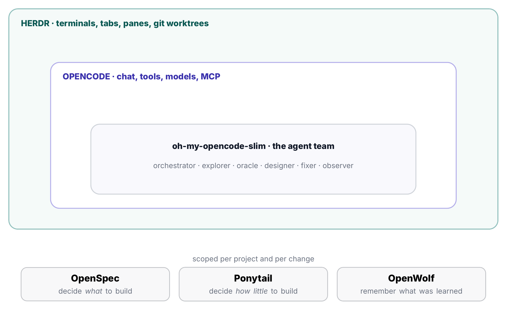

# OpenCode Stack — Field Guide

A practical guide to running six AI coding tools as one workflow:

| Tool | Role |
|------|------|
| [OpenCode](https://github.com/anomalyco/opencode) | The host: chat, agents, tools, models |
| [oh-my-opencode-slim](https://github.com/alvinunreal/oh-my-opencode-slim) | Agent team (orchestrator, explorer, oracle, fixer, ...) |
| [OpenSpec](https://github.com/Fission-AI/OpenSpec) | Decides what to build |
| [Ponytail](https://github.com/DietrichGebert/ponytail) | Decides how little to build |
| [OpenWolf](https://github.com/cytostack/openwolf) | Remembers what was learned |
| [Herdr](https://github.com/herdrdev/herdr) | Terminals, worktrees, parallel agents |

The model is not the hard part. The handoffs are: what gets built, by whom,
how much code, and what we remember afterwards. This guide covers install,
commands, file locations, security, templates, and four real workflows.

Versions reflect October 2026.

## Read it

- [Full guide (Markdown)](guide.md)
- [Full guide (PDF)](opencode-stack-user-guide.pdf)

## What's inside

1. The stack at a glance
2. Install from zero
3. Where everything lives
4. OpenCode: the host
5. oh-my-opencode-slim: the agent team
6. OpenSpec: decide what to build
7. Ponytail: decide how little to build
8. OpenWolf: project memory
9. Herdr: terminal workspace manager
10. Security and permissions
11. When not to use the stack
12. Working with all six together
13. Cheat sheet
14. Troubleshooting
15. Appendix A: templates
16. Appendix B: glossary
17. Appendix C: versions, licenses and sources

## Note

OpenCode, OpenSpec, Ponytail and Herdr are third-party projects. This guide
documents how I use them together. Each tool is governed by its own license.