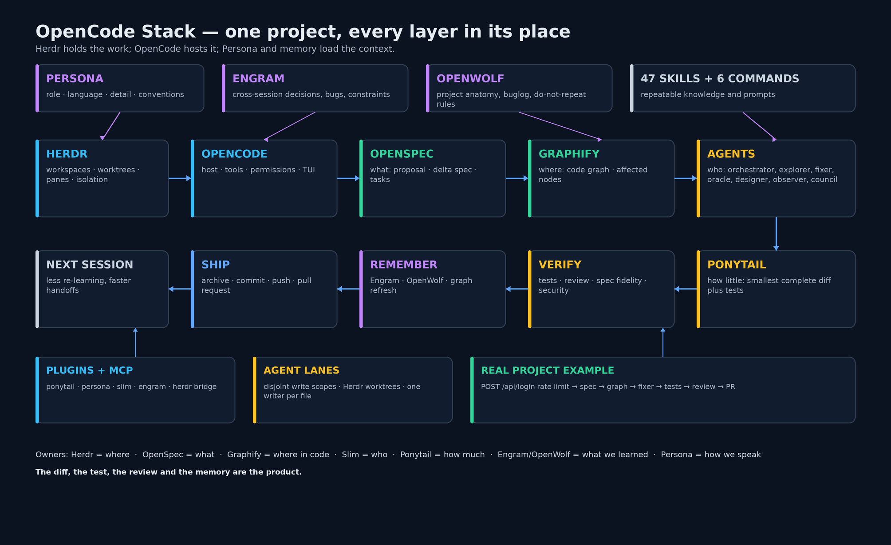

# OpenCode Stack — Field Guide: OpenCode, oh-my-opencode-slim, OpenSpec, Ponytail, OpenWolf, Herdr, Engram, Persona, Graphify, skills and commands

A field guide for contributors using the OpenCode stack in a shared, open-source repository. It describes what each tool owns, how the tools hand work to one another, and how to carry one change from a vague idea to a reviewed, remembered pull request.

## Read this repository in this order

1. **Start here** — this README: what the repo contains and how to use it.
2. **Look at the map** — the diagram below: who owns which decision in the stack.
3. **Learn one tool at a time** — [guide.md](guide.md), sections 1–11 and 21.
4. **Learn the handoffs** — sections 14 and 22: how the whole stack works on one real change.
5. **Follow a full project** — section 20: beginner → advanced → expert.
6. **Use the styled rendering** — [opencode-stack-user-guide.pdf](opencode-stack-user-guide.pdf) when a printable or shareable copy is needed.

## The stack in one sentence

Herdr isolates the work, OpenCode hosts the agent, Persona sets how the agent behaves, Engram and OpenWolf remember what was learned, OpenSpec decides what to build, Graphify maps where it lives, oh-my-opencode-slim decides who does it, Ponytail keeps the diff small, and skills plus custom commands make the repeatable parts cheap.

| Tool | Role |
|------|------|
| [OpenCode](https://github.com/anomalyco/opencode) | Host: chat, agents, tools, models, permissions |
| [oh-my-opencode-slim](https://github.com/alvinunreal/oh-my-opencode-slim) | Agent team: orchestrator, explorer, oracle, designer, fixer, observer, council |
| [OpenSpec](https://github.com/Fission-AI/OpenSpec) | Scope: proposals, delta specs, tasks, archive |
| [Ponytail](https://github.com/DietrichGebert/ponytail) | Discipline: smallest complete change |
| [OpenWolf](https://github.com/cytostack/openwolf) | Project-local memory: anatomy, buglog, do-not-repeat rules |
| [Herdr](https://github.com/herdrdev/herdr) | Terminal workspace: sessions, panes, worktrees, agent control |
| [Engram](https://engram.tools/) | Cross-session memory: decisions, bugs, constraints |
| [Persona](https://github.com/RuloGB/opencode-persona) | Role, language, detail level, project conventions |
| [Graphify](https://github.com/Graphify-Labs/graphify) | Code graph: dependencies, affected nodes, paths |

The reference setup also has 47 available skills, six custom slash commands, agents, plugins and one MCP server. Section 21 of the guide inventories all of them.

## Diagram

This diagram is embedded in the README and the guide. Regenerate it with `python3 make_diagram.py` whenever the tools, roles, skills, commands or the real-project flow change.

## What's inside

1. The stack at a glance
2. Install from zero
3. Where everything lives
4. OpenCode: the host
5. oh-my-opencode-slim: the agent team
6. OpenSpec: decide what to build
7. Ponytail: decide how little to build
8. OpenWolf: project memory
9. Herdr: terminal workspace manager
10. Persona: role, language and conventions
11. Engram: the memory layer
12. Security and permissions
13. When not to use the stack
14. Working with the whole stack together
15. Cheat sheet
16. Troubleshooting
17. Appendix A: templates
18. Appendix B: glossary
19. Appendix C: versions, licenses and sources
20. Beginner to expert: a complete project run
21. Complete inventory: tools, skills, agents and commands
22. Real project walkthrough: every tool in its place

## Repository map

| File | Purpose |
|------|---------|
| `guide.md` | Canonical Markdown source for the full guide |
| `README.md` | Entry point for readers and contributors |
| `diagram.png` | Full-stack workflow diagram |
| `make_diagram.py` | Source for regenerating the diagram |
| `opencode-stack-user-guide.pdf` | Styled PDF rendering of the guide |

## How the stack works together

| Decision | Owner |
|----------|-------|
| Where the work happens | Herdr |
| How the agent addresses the team | Persona |
| What was decided earlier | Engram; OpenWolf for project-local history |
| What is being built | OpenSpec |
| Where the code lives and what a change touches | Graphify |
| Who does the work | oh-my-opencode-slim |
| How little code is written | Ponytail |
| How the change is remembered | Engram, OpenWolf, `graphify update` |
| How the change ships | git, pull request, release |

Section 22 walks one concrete change — adding per-IP rate limiting to a login endpoint — through every step above.

## Contributing and maintenance

For every change to this guide, the team does all of these in the same pass:

1. Update `guide.md`; update this README index and caption when the structure changes.
2. Run `python3 make_diagram.py` if the stack, roles, skills, commands or flow change.
3. Rebuild `opencode-stack-user-guide.pdf` from the updated Markdown.
4. Verify `git diff --check`, the PDF build and margins, and diagram readability.
5. Commit and push the Markdown, README, diagram and PDF together.
6. Publish a new GitHub release with those files; never rewrite an older release.

Keep changes focused: one change, one clear story, one reviewable diff. Write for the next contributor, not for the author of the change.

## Releases

Published releases are listed in the [GitHub releases page](https://github.com/rafaabou/opencode-stack-guide/releases). Each release carries the current Markdown, README, diagram, PDF and diagram source.

## Note

OpenCode, OpenSpec, Ponytail, Herdr and the other tools listed here are third-party projects. This guide documents a shared workflow for using them together. Each tool is governed by its own license; see guide section 19 for the version and source table. Versions were last re-checked on 2026-11-27.
