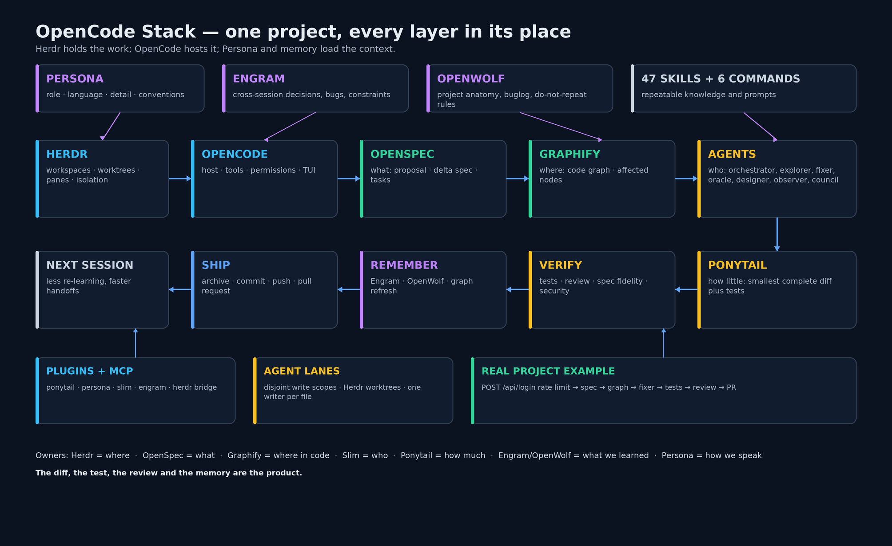

# OpenCode Stack — Full User Guide

A practical field guide to running the OpenCode stack: six core AI tools —
**OpenCode**, **oh-my-opencode-slim**, **OpenSpec**, **Ponytail**, **OpenWolf**
and **Herdr** — plus the memory, persona and code-graph layers that make them
work together.
Install, commands, file locations, security, templates, the workflows I use
daily, and a beginner-to-expert runbook (section 20). Versions re-checked
2026-11-27 against official releases.

## 1. The stack at a glance

| Tool | Role | Runs as |
|------|------|---------|
| **OpenCode** | The AI coding host: chat, agents, tools, models | `opencode` CLI/TUI (v2.4.2) |
| **oh-my-opencode-slim** | Agent team + presets on top of OpenCode (orchestrator, explorer, oracle, designer, fixer, observer, council) | TUI plugin + agent presets |
| **OpenSpec** | Spec-driven development: proposals, specs, tasks, archive | `openspec` CLI (2.2.0) + OpenCode skills |
| **Ponytail** | Coding style: smallest complete change, no over-engineering | OpenCode plugin (level: full) |
| **OpenWolf** | Project memory: file anatomy, bug fixes, do-not-repeat rules | OpenCode plugin (`.wolf/`) |
| **Herdr** | Terminal workspace manager: sessions, tabs, panes, git worktrees, agent control | `herdr` CLI + server |
| **Engram** | Cross-session memory: decisions, bugs, constraints, resumption state | MCP server + local plugin |
| **Persona** | Role, language, detail level, project conventions | Package plugin |
| **Graphify** | Knowledge graph: where code lives and what a change touches | `graphify` CLI + OpenCode skill/plugin |
| **Skills** | 47 on-demand instruction packs (17 user-installed, 30 built-in) | `SKILL.md` folders; `/skill-name` or natural language |
| **Custom commands** | Six reusable prompts: plan, execute, surgery, Feynman, humanize, war room | `~/.config/opencode/commands/` |

Mental model: **Herdr** holds the terminals, **OpenCode** is the agent inside
each pane, **oh-my-opencode-slim** gives that agent a team, **OpenSpec** decides
*what* to build, **Ponytail** decides *how little* to build, **OpenWolf**
remembers what was learned. Persona sets how the agent speaks; Engram remembers
what it learned across sessions; Graphify maps the code before you touch it.
Sections 14 and 20 are the worked versions of this loop; section 21 is the
complete inventory.



---

## 2. Install from zero

Order matters: host first, then plugins, then the companion CLIs. These commands
reflect the versions in Appendix C; check `--version` after each step.

Prerequisites: Linux x86_64, `bash`, `curl`, `git`, and Node 20+ for the
npm-installed CLIs and plugin hooks. Docker, OpenTofu and Ansible are optional —
install them only if your work needs them.

```bash
# 1. OpenCode — the host
curl -fsSL https://opencode.ai/v2/install | bash

# 2. OpenSpec — specs and change artifacts (CLI optional on this machine)
#    skills are already installed in ~/.opencode/skills/
#    npm install -g @fission-ai/openspec@latest

# 3. oh-my-opencode-slim — the agent team
bunx oh-my-opencode-slim@latest install
#    no Bun? npx oh-my-opencode-slim@latest install

# 4. Ponytail — coding discipline
opencode plugin add @dietrichgebert/ponytail

# 5. OpenWolf — project memory
npm install -g openwolf
openwolf init --agent opencode

# 6. Engram + Persona — memory and role (already active here)
engram setup opencode        # MCP server + ~/.config/opencode/plugins/engram.ts
opencode plugin add opencode-persona

# 7. Herdr — terminal workspace
curl -fsSL https://herdr.dev/install.sh | sh
```

Then verify:

```bash
opencode --version      # v2.4.2 (open the v2 install channel; npm `opencode-ai` latest is the v1 line, 1.19.6)
herdr --version         # 0.9.5
graphify --version      # 0.9.121 (only if you installed the optional add-on)
engram --version        # 3.7.2
herdr status            # client/server state, not a version check
```

The OpenSpec **skills** are installed (`~/.opencode/skills/openspec-*`), but the
`openspec` CLI is not currently on this machine's PATH. Install it with
`npm install -g @fission-ai/openspec@latest` (latest release 2.2.0) if you want
`openspec list`, `validate`, `archive` and the other terminal commands.

### Where each piece registers

| Tool | Registers as | Lives in |
|------|--------------|----------|
| OpenCode | Host binary | `~/.local/bin/opencode` |
| oh-my-opencode-slim | Package plugin | `~/.config/opencode/opencode.json` → `plugins`; config `oh-my-opencode-slim.jsonc` |
| Ponytail | Package plugin | `~/.config/opencode/opencode.json` → `plugins` |
| OpenWolf | Local plugin directory | `~/.config/opencode/plugins/openwolf/` |
| OpenSpec | Skills + optional standalone CLI | `~/.opencode/skills/` (global), `openspec/` per project |
| Herdr | Standalone CLI, not a plugin | `~/.local/bin/herdr` |
| Engram | Local plugin + MCP server | `~/.config/opencode/plugins/engram.ts`, `opencode.json` → `mcp` |
| Persona | Package plugin | `~/.config/opencode/opencode.json` → `plugins` |
| Custom commands | Six `.md` prompt templates | `~/.config/opencode/commands/` |

`opencode plugin list` only reports managed package plugins. It will not show
local files or terminal-only plugins. Check the three surfaces directly: the
`plugins` array in `opencode.jsonc`, the `plugins` array in `cli.json`, and the
contents of `~/.config/opencode/plugins/` and project `.opencode/plugins/`.

After installing, start `opencode` once and run `/mcps` if you use MCP servers.

Permissions and policies: see section 12 for the security and permissions chapter.
Updates are `opencode upgrade`, `openspec update`,
`npm i -g @fission-ai/openspec@latest`, `herdr update`, and
`opencode plugin update`. Run `opencode plugin check` to see which package
plugins are outdated.

---

## 3. Where everything lives

| Path | What it is |
|------|------------|
| `~/.config/opencode/opencode.json` | Main OpenCode config on this machine: providers, models, plugins, MCP (`.jsonc` also supported) |
| `~/.config/opencode/cli.json` | TUI/CLI settings, including terminal-only plugins |
| `~/.config/opencode/oh-my-opencode-slim.jsonc` | Agent presets, models, multiplexer (Herdr) |
| `~/.config/opencode/plugins/` | Auto-loaded global plugins (`engram.ts`, `graphify.js`, `herdr-agent-state.js`, `openwolf/`) |
| `~/.config/opencode/commands/` | Six custom slash command templates |
| `~/.config/opencode/skills/` | 17 user-installed skills (`SKILL.md` folders) |
| `~/.engram/engram.db` | Engram's SQLite + FTS5 memory store |
| `~/.opencode/skills/openspec-*` | Global OpenSpec workflow skills |
| `~/.config/opencode/opencode.json` | MCP registry (`engram`) and plugin list |
| `.opencode/plugins/` (per project) | Auto-loaded local plugin files and directories |
| `~/.config/opencode/skills/graphify/` | Graphify skill (`SKILL.md`) |
| `harness/user-roles/` (per project) | Persona role definitions (`DEV.md`, `ARQ.md`, ...) |
| `graphify-out/` (per project) | Generated knowledge graph |
| `~/.config/opencode/plugins/graphify.js` | Graphify reminder hook (auto-loaded) |
| `~/.config/opencode/.ponytail-active` | Current Ponytail level (`full`) |
| `~/.config/ponytail/config.json` | Optional Ponytail default mode |
| `~/.config/openspec/config.json` | Global OpenSpec config |
| `~/.config/herdr/config.toml` | Herdr config |
| `~/.config/herdr/herdr.sock` | Herdr server socket |
| `.wolf/` (per project) | OpenWolf project memory |
| `openspec/` (per project) | OpenSpec specs and changes |

---

## 4. OpenCode — the host

### Start

```bash
opencode                 # TUI in the current directory
opencode /path/to/proj   # TUI in another directory
opencode -c              # continue the last session
opencode -s <session-id> # continue/create a specific session
opencode run "message"   # one-shot, non-interactive
opencode service start   # v2 background server (API + web)
opencode api ...          # make a request to the running server
```

Useful subcommands:

```bash
opencode models          # list available models
opencode mcp add <name> --global --url <url>   # e.g. context7 --url https://mcp.context7.com/mcp
opencode mcp list
opencode mcp logout <name>
opencode auth login      # add a provider credential
opencode plugin add @dietrichgebert/ponytail
opencode plugin list
opencode plugin list --builtin
opencode plugin check
opencode plugin update [@dietrichgebert/ponytail]
opencode plugin remove @dietrichgebert/ponytail
opencode session list
opencode session delete    # Delete a session and its child sessions
opencode session export     # Export session data as JSON
opencode session import     # Import session data from JSON or URL
opencode reload          # reload config
opencode upgrade
opencode stats
opencode debug --help    # troubleshooting tools
```

### Inside the TUI

- Type a request and press Enter. Use `Tab` / the agent switcher to change agent.
- `/` opens the command menu: `/models`, `/sessions`, `/new`, `/init`, `/undo`,
  `/redo`, `/compact`, `/share`, `/help` (exact set depends on version).
- `Ctrl+P` opens the command palette in most builds.
- Subagents are called by name, e.g. `@explorer find every caller of foo`.

### Config

`opencode.jsonc` holds `providers`, `disabled_providers` and `plugins` (array).
OpenCode 1 used `plugin`; a config migrated from v1 can still have both:

```jsonc
"plugin":  ["opencode-models-discovery@1.8.0", "oh-my-opencode-slim"],
"plugins": ["@dietrichgebert/ponytail"]
```

Rules of thumb:

- OpenCode 2 uses **`plugins`** (array). OpenCode 1 uses **`plugin`**.
- A configured path entry must point to a **directory**, never a single file.
  Direct `.ts`/`.js` files are discovered only inside `.opencode/plugins/`.
- A checkout can be shared with `"/absolute/path/to/checkout/.opencode/plugins"`.
- Prefix an ID with `-` to disable it, or use `"*"` to affect every plugin.
- Config changes reload automatically; use `/reload` or `opencode reload` to force it.

```bash
opencode plugin list --builtin   # include built-in plugins
opencode plugin check            # report outdated package plugins
opencode plugin update           # update all; or name one package
```

`cli.json` holds terminal-only settings and TUI plugins; keep it separate from
`opencode.jsonc` so UI changes do not touch providers and models.

### Optional add-on: Graphify

[Graphify](https://github.com/Graphify-Labs/graphify) is a local code knowledge
graph: tree-sitter AST parsing (no LLM for code), every edge tagged EXTRACTED or
INFERRED, and a graph you query instead of grepping files. It installs as an
OpenCode skill plus a small plugin hook, not with `opencode plugin add`.

```bash
uv tool install graphifyy          # PyPI name has two y's; CLI is `graphify`
graphify install --platform opencode          # global skill + plugin hook
graphify opencode install --project           # or project-local .opencode/skills/
```

Open a new session, then `/graphify .` to build `graphify-out/` and query it:

```bash
graphify extract . --code-only   # headless build (CI/scripts)
graphify query "what connects auth to the database?"
graphify path "UserService" "DatabasePool"
graphify explain "RateLimiter"
graphify affected "RateLimiter"  # what breaks if it changes
graphify god-nodes               # architectural hubs
graphify update .                  # refresh after changes
graphify hook install              # auto-rebuild on commits
```

Requires Python 3.11.5–3.14 and `uv` (or `pipx`). The plugin hook adds a
one-time reminder before the first shell command when `graphify-out/` exists;
the graph itself stays local. Do not confuse it with the unrelated npm package
named `graphify`.

---

## 5. oh-my-opencode-slim — the agent team

Installed as an OpenCode plugin; configuration in
`~/.config/opencode/oh-my-opencode-slim.jsonc` (or `.opencode/oh-my-opencode-slim.jsonc`
per project). The installer creates `openai` and `opencode-go` presets; the
`free` preset used in this guide is a custom one. Presets are defined in that file.

### Agents

| Agent | Use it for |
|-------|-----------|
| **orchestrator** (default) | Plans, splits work into lanes, dispatches, reconciles, verifies |
| **@explorer** | Read-only search: codebase recon, docs/web research |
| **@oracle** | Architecture, risk, debugging strategy, review — escalation only |
| **@designer** | All UI/UX: layout, hierarchy, spacing, motion, responsive feel |
| **@fixer** | Bounded, well-defined implementation; parallel per-area lanes |
| **@observer** | Image/PDF/diagram analysis (pass the full file path) |
| **council** | Multi-model consensus, seats `alpha`, `beta`, `gamma` |

The orchestrator is lazy about delegating: small, in-context changes it does
itself; anything non-trivial goes to a specialist. Parallel lanes are only
dispatched when their write scopes do not overlap.

### Configuration

The JSON file sets, per preset: model, variant, disabled agents, image routing,
multiplexer and the council roster. `preset: "free"` selects the free-model set;
`/preset <name>` switches presets in the current session. Background delegation
is the default; a multiplexer such as Herdr, Tmux or Zellij shows each agent in
its own pane.
Backups (`*.bak-*`) are kept next to it — restore one if an edit breaks things.

To tune agents, models, skills, MCPs or presets, load the `oh-my-opencode-slim`
skill in OpenCode and ask; it knows the schema and the safe edit flow.

### Calling agents

- Let the orchestrator delegate automatically for non-trivial work.
- Force one directly: `@explorer ...`, `@fixer ...`, `@oracle ...`.
- Council: ask for "a council" on a decision; seats answer in parallel and a
  synthesis step merges them.

---

## 6. OpenSpec — decide what to build

OpenSpec turns a request into artifacts: **proposal → specs (delta) → design →
tasks**, then implements and archives. Release 2.2.0 installed its **skills**
globally in `~/.opencode/skills/`; the standalone CLI is optional and is not on
this machine's PATH. Since 2.0 the old `/opsx:*` commands are gone — use the
`openspec-*` skills or the router.

### Initialize a project

```bash
cd /path/to/project
openspec init
```

This creates the `openspec/` directory and the instruction/skill files.

### Core loop

```bash
openspec list                 # active changes
openspec list --specs         # current specs
openspec view                 # interactive dashboard
openspec show <change>        # one change
openspec status <change>      # artifact completion
openspec validate <change>    # structural validation
openspec archive <change>     # archive + merge deltas into main specs
openspec update               # add/refresh skills after upgrading OpenSpec
openspec doctor               # health of the OpenSpec root
openspec context              # print working context
```

Change management:

```bash
openspec change show <name>
openspec change validate <name>
openspec spec list
openspec spec show <spec-id>
openspec spec validate <spec-id>
```

### Skills inside OpenCode

These are the workflow shortcuts (invoke them by name or just ask in plain words):

| Skill | Purpose |
|-------|---------|
| `openspec` | Router: describe the task in words; it picks the skill (v2.2+) |
| `openspec-new-change` | Start a change (proposal first) |
| `openspec-continue-change` | Create the next artifact |
| `openspec-ff-change` | Fast-forward all artifacts in one pass |
| `openspec-propose` | Full proposal (design + specs + tasks) at once |
| `openspec-apply-change` | Implement the tasks |
| `openspec-verify-change` | Check implementation against artifacts |
| `openspec-archive-change` | Archive a completed change |
| `openspec-bulk-archive-change` | Archive several at once |
| `openspec-sync-specs` | Merge delta specs without archiving |
| `openspec-update-change` | Revise a plan and keep artifacts coherent |
| `openspec-explore` | Thinking partner before/while a change |
| `openspec-onboard` | Guided end-to-end walkthrough |

The router does not replace the workflow skills — every named skill still works.

### Example

```text
You:  "openspec new change: add CSV export to the reports page"
AI:   proposal → specs → design → tasks
You:  "openspec apply"
AI:   implements task by task (Ponytail rules apply)
You:  "openspec verify" then "openspec archive"
```

Use OpenSpec when the work deserves a paper trail. For a one-line fix, skip it —
that is the Ponytail rule too.

---

## 7. Ponytail — decide how little to build

Run this stack at **full** (the active level is stored in `.ponytail-active`). It is one prompt that
shapes every coding reply:

1. Does this need to exist at all? (YAGNI)
2. Is it already in this codebase?
3. Does the standard library do it?
4. Is there a native platform feature?
5. Is there an installed dependency?
6. Can it be one line?
7. Only then: the minimum code that works.

Never cut: trust-boundary validation, error handling that prevents data loss,
security, accessibility, or anything you explicitly asked for. Non-trivial logic
leaves one small test behind. Every reply ends with what was skipped and the risk.

### Levels

| Level | Behavior |
|-------|----------|
| `lite` | Build what was asked; name the lazier option in one line |
| `full` (default) | The ladder above |
| `ultra` | Deletion before addition; challenges the requirement before building |
| `off` | Disabled |

### Commands

| Command | What it does |
|---------|--------------|
| `/ponytail` | Report level; turn on at default if off |
| `/ponytail lite\|full\|ultra\|off` | Switch level |
| `/ponytail-review` | Review current diff: bugs, security, load, tests, speed, cuts |
| `/ponytail-audit` | Same checks for the whole repo, ranked |
| `/ponytail-debt` | Collect `shortcut:` comments into a ledger |
| `/ponytail-gain` | Benchmark scoreboard |
| `/ponytail-help` | Quick reference |

Deactivate with `stop ponytail`, `normal mode`, or `/ponytail off`. Resume with
`/ponytail`.

The full discipline rules live in section 13.

### Defaults

Resolution order: `PONYTAIL_DEFAULT_MODE` env var → `~/.config/ponytail/config.json`
(`{"defaultMode": "lite"}`) → `full`.

### `shortcut:` comments

A deliberate simplification gets:

```js
// shortcut: supports one level of nesting, upgrade when the tree editor lands
```

`/ponytail-debt` harvests these so "later" does not become "never".

---

## 8. OpenWolf — project memory

Plugin: `~/.config/opencode/plugins/openwolf/` (auto-loaded directory, V2 entry
`index.ts`). Data lives in `.wolf/` in each project.

| File | Contents |
|------|----------|
| `.wolf/OPENWOLF.md` | Rules the agent follows |
| `.wolf/anatomy.md` / `.wolf/anatomy-index.json` | File descriptions/sizes — check before reading a file |
| `.wolf/cerebrum.md` | Do-not-repeat rules — check before writing |
| `.wolf/buglog.json` | Logged bugs/fixes |
| `.wolf/memory.md` | General memory |
| `.wolf/token-ledger.json` | Token accounting |

Releases 2.5+ use `.wolf/anatomy-index.json` (and support native OpenCode v2
events); older installs use `anatomy.md`. Check whichever file exists.

Workflow it enforces:

1. Before reading a file, check the anatomy file.
2. Before writing, check `cerebrum.md`.
3. After fixing a bug, log it (`wolf_log_bug`).
4. When corrected, record it (`wolf_learn`).
5. Before debugging, search known fixes (`wolf_search_bugs`).

If `.wolf/` is missing in a project, the plugin starts it. If you work in many
repos, let each one build its own memory — do not share `.wolf/` between
projects.

---

## 9. Herdr — terminal workspace manager

Binary: `~/.local/bin/herdr`. It runs a local server and keeps sessions alive
across terminal restarts.

### Start

```bash
herdr                          # launch or attach to the persistent session
herdr --session <name>         # named session
herdr status                   # client/server status
herdr server stop              # stop the server
herdr server reload-config     # apply config.toml changes
herdr update                   # self-update
herdr channel set stable|preview
```

### Core objects

```
session → workspace → tab → pane → agent
```

```bash
herdr session attach <name>
herdr workspace list|create|get|focus|rename|close
herdr worktree list|create|...        # git worktree helpers
herdr tab ...
herdr pane ...
```

### Agent control (the useful part)

```bash
herdr agent list                      # running agents in panes
herdr agent get <agent>
herdr agent read <agent>              # read terminal output
herdr agent prompt <agent> "..."      # submit a prompt
herdr agent send-keys <agent> ...     # send key presses
herdr agent wait <agent> --state <s>  # block until a state
herdr agent start <agent>             # start a supported agent in a pane
herdr agent attach <agent>            # attach directly
```

Typical setup: one workspace per project, one pane running `opencode`, more
panes running tests/servers. Herdr keeps them alive; the OpenCode plugin
`herdr-agent-state.js` mirrors agent state into the session.

### Remote and multi-machine

```bash
herdr --remote <ssh-target> [--session <name>]
herdr machine add|list|remove ...
```

Config: `~/.config/herdr/config.toml` (UI, onboarding and keybindings). Agents can ask Herdr for its own skill with `herdr --skill`;
human setup guide: <https://herdr.dev/agent-guide.md>.

---

## 10. Persona — role, language and conventions

Persona decides **how the assistant behaves for you**. It does not decide what
gets built (OpenSpec), how little code is written (Ponytail) or what is remembered
(Engram). The role *definitions* are shared in the repo; *your* role and
preferences are personal and live in Engram on your machine.

### Install and verify

Persona needs Engram installed first — it stores everything there. Pin the
version so a later release cannot change your sessions silently:

```bash
opencode plugin add opencode-persona@3.0.0
opencode plugin list                      # look for opencode-persona
mkdir -p harness/user-roles               # DEV.md ARQ.md BA.md QA.md DL.md
```

The first session asks for your role; answer once and it loads automatically
after that. Acceptable roles: `developer`, `architect`, `analyst`, `qa`,
`delivery`. Each role reads its own file from `harness/user-roles/` in the
**project**, so the same role can behave differently in different repos. On this
machine the role is `architect` but `harness/user-roles/ARQ.md` is missing, so
Persona falls back to its default behaviour — add that file to get the full role.

### Configure it by chat

There are no slash commands and no config file to edit. Just say what you want;
the assistant calls the Persona tools itself.

| Say | Result |
|-----|--------|
| "change my role to QA" | `save_user_role` updates the role in place |
| "always reply in English" | `save_user_preferences` sets language |
| "be more brief" | `save_user_preferences` sets detail level |
| "commits in this repo are in English" | `save_convention` (project scope) |
| "save as a global convention: never use any" | `save_convention` (global scope) |
| "what do I have recorded in Persona?" | `get_persona_status` reads the local database |

`get_persona_status` reports what is **actually stored**, not what a repo doc
claims. Role and preferences are personal and follow you across projects;
project conventions stay in that project; global conventions go everywhere.
Nothing is shared with teammates except the role files in the repo.

### OpenCode v2 caveats

On v2 there is no active-role line prepended to replies, and no update notice;
the role is still injected, and save confirmations carry the `Persona plugin:` marker. Subagent sessions are ignored. A missing role file is reported and the
session continues with default behaviour. Logs: `~/.persona/persona.log`.

---

## 11. Engram — the memory layer

Engram is a single Go binary with SQLite + FTS5 (`~/.engram/engram.db`) exposed
over MCP, a local HTTP API and a TUI. It remembers decisions, bugs, constraints
and resumption state **across sessions and projects**. This is different from
OpenWolf: OpenWolf's `.wolf/` is project-local anatomy and buglog; Engram is the
curated cross-project brain.

### Install and verify

```bash
engram setup opencode         # writes MCP entry into opencode.json
# restart OpenCode after setup
engram --version              # 3.7.2 here
engram doctor                 # read-only store diagnostics
```

The MCP entry on this machine runs `engram mcp --tools=agent` from
`~/.config/opencode/opencode.json`. Persona depends on this working.

### Use it deliberately

Treat Engram as a curated memory, not a transcript sink. The agent calls these
MCP tools on its own, but you can ask for them explicitly:

| Intent | Tool |
|--------|------|
| Confirm the current project | `mem_current_project` |
| Recover recent work | `mem_context` |
| Find prior knowledge before repeating it | `mem_search` |
| Inspect a full observation (search gives previews) | `mem_get_observation` |
| Save a durable decision, bugfix or pattern | `mem_save` |
| Update an evolving topic instead of duplicating | `mem_update` with a stable `topic_key` |
| Hand off a session | `mem_session_summary` |

A useful memory has a short searchable title, a type (`decision`, `bugfix`,
`pattern`, `architecture`, `config`, ...) and `**What** / **Why** / **Where** /
**Learned**` content. Search before re-deriving anything, and never store raw
dumps, secrets or routine progress. Browse everything with `engram tui`
(`j`/`k`, `/` to search, `Enter` to open, `c` to copy).

---

## 12. Security and permissions — what the agent may touch

The agent runs as **you**. Every tool call uses your UID, your filesystem, your
network, your SSH agent and any cloud token in your environment. Permissions
reduce accidents. They do not contain a hostile prompt.

### 12.1 The trust model

- `read`, `edit` and `shell` reach anything your user can reach.
- `external_directory` **defaults to allow** outside the project — add an `ask`
  rule if you want a prompt.
- An `ask` can be approved as "always", which stores a durable allow rule.
  A `deny` is never overridden by that.
- `policies` run last and can only hard-deny. They are the only layer a saved
  approval cannot loosen.
- Shell checks use a best-effort scanner. Compound commands, `eval`, and
  anything dynamic are where it stops being reliable.

### 12.2 A starter policy

Put shared rules at the top level, narrow rules after them (last match wins):

```jsonc
"permissions": [
  { "action": "shell", "resource": "*", "effect": "ask" },
  { "action": "shell", "resource": "git status *", "effect": "allow" },
  { "action": "shell", "resource": "git diff *", "effect": "allow" },
  { "action": "shell", "resource": "git log *", "effect": "allow" },
  { "action": "read", "resource": "*.env", "effect": "deny" },
  { "action": "read", "resource": "*.env.*", "effect": "deny" },
  { "action": "read", "resource": "*.ssh/*", "effect": "deny" },
  { "action": "read", "resource": "*.pem", "effect": "deny" },
  { "action": "read", "resource": "*.config/gh/*", "effect": "deny" },
  { "action": "external_directory", "resource": "*", "effect": "ask" },
  { "action": "shell", "resource": "tofu apply *", "effect": "ask" },
  { "action": "shell", "resource": "tofu destroy *", "effect": "deny" },
  { "action": "shell", "resource": "ansible-playbook *", "effect": "ask" }
],
"policies": [
  { "action": "tool.use", "resource": "shell:sudo *", "effect": "deny" },
  { "action": "tool.use", "resource": "shell:ssh *", "effect": "deny" },
  { "action": "tool.use", "resource": "shell:gh auth token*", "effect": "deny" },
  { "action": "tool.use", "resource": "shell:docker system prune *", "effect": "deny" },
  { "action": "tool.use", "resource": "shell:git push --force*", "effect": "deny" }
]
```

Paths in `read` and `external_directory` rules expand `~`, `$HOME` and
`$HOME/`. Shell resources do **not** — write them as plain command text.

### 12.3 Keys and secrets

A **public** key is not a secret. Paste it into the chat as text when you want
it reviewed; no file access and no shell needed.

A **private** key is different. Never paste it, never put it in the project, and
assume anything that reaches a model is logged. If it leaks, rotate it — deleting
the message is not enough.

If your keys are loaded in `ssh-agent`, any shell command can sign with them.
Starting OpenCode without the agent socket removes that capability:

```bash
env -u SSH_AUTH_SOCK opencode
```

Provider keys belong in `{file:...}` indirection, not inline in the config.
The value is a path such as `secrets/provider.key`.

### 12.4 MCP servers are context and trust

- Every server injects its tool schemas into **every** prompt. Three to five
  servers is a working ceiling; ten is self-harm.
- Prefer a read-only token with the smallest scope. For GitHub, restrict
  toolsets to `repos`, `pull_requests`, `actions`, `code_security`.
- A local MCP server runs with your authority and is a supply-chain dependency.
  Install only what you would run yourself.
- Never give a generic database MCP a production credential.

### 12.5 What this does not do

Permissions are guardrails, not a sandbox. A container or VM with no key
material, no cloud credentials and no network is the only real isolation for
untrusted code or untrusted input. Treat repository files and web pages as
untrusted input: a prompt injection can ask the agent to run the commands you
left allowed.

One more trap: `!` shell blocks inside custom commands execute **before** the
prompt is submitted and outside the normal permission flow. Never build a
command that pastes untrusted arguments into one.

---

## 13. When not to use the stack

The failure mode of a good workflow is ceremony. These are the cases where the
right move is to drop a layer.

| Situation | Skip | Why |
|-----------|------|-----|
| One-line fix, obvious cause | Everything except plain ask | A spec costs more than the diff |
| Spike or unknown problem | OpenSpec | You cannot specify what you have not found yet |
| Throwaway script | OpenSpec, council | No maintenance, no audience, no paper trail |
| Context already near the limit | MCP servers, extra subagents | Every tool schema and child session spends context |
| Production credentials in play | The whole stack | Use a short-lived token in a container, or do it yourself |
| Latency-critical loop | Parallel lanes, council | Model calls dominate; parallelism multiplies spend |
| Repo has strong `AGENTS.md` | Ponytail defaults | Project conventions win; drop to `lite` |

Three rules of thumb:

1. **If a CLI already does it, use the CLI.** A scanner does not need an MCP
   server; `tofu validate`, `ansible-lint` and `trivy` are shell commands.
2. **If the answer fits in one sentence, do not open a change.** OpenSpec earns
   its cost when the work spans days or people.
3. **Every subagent is a fresh context.** A council of three plus a verifier is
   four full reads of the problem. Use it for decisions that are expensive to
   get wrong, not for routine edits.

The stack is at its best on multi-file changes with a review gate. On a
20-line fix it should feel like nothing is there.

---

## 14. Working with the whole stack together — maximum gain

### 14.1 Who decides what

Each tool owns one decision. Overlap is what makes stacks feel heavy; keep the
jobs separate.

| Decision | Owner | Not the others |
|----------|-------|----------------|
| Where the work happens (terminals, panes, isolation) | **Herdr** | OpenCode stays inside one pane |
| What is being built (scope, acceptance, proof) | **OpenSpec** | the agent does not invent scope |
| Who does the work (plan, delegate, review) | **oh-my-opencode-slim** | you do not micromanage lanes |
| How much code is written | **Ponytail** | no gold-plating, no stubs |
| What was learned (bugs, rules, file map) | **OpenWolf** | no re-debugging the same bug |
| What was decided in an earlier session | **Engram** | no re-deriving old decisions |
| Where code lives and what depends on it | **Graphify** | no blind grep or full-file reads |
| How the assistant addresses you | **Persona** | role, language and detail are not re-explained |

### 14.2 The loop

```text
Herdr          OpenSpec        orchestrator      Ponytail        reviewers        OpenWolf
where     →    what       →    who          →    how much   →    is it safe?  →   remember
(panes)        (change)        (subagents)       (min diff)      (review)         (.wolf)
   ↑                                                                                  │
   └────────────────────────── next task / parallel lane ────────────────────────────┘
```

Start in Herdr, decide scope with OpenSpec when it is worth it, let the
orchestrator route the work, let Ponytail keep it small, review with the Ponytail
checkers, and let OpenWolf keep the lessons. Persona loads first; Engram and
OpenWolf answer "have we seen this before?" at different scopes; Graphify maps
the code before you change it.

### 14.3 Weight the process to the task

Process is a cost. Match it to the size of the change.

| Size | Process | Commands |
|------|---------|----------|
| One-line fix / typo | none | just ask; Ponytail full |
| Small fix, few files | light | ask → `/ponytail-review` |
| Feature, multi-file | spec | OpenSpec change → apply → verify → archive |
| Big / risky / parallel | spec + isolation | OpenSpec + Herdr worktrees + parallel `@fixer` lanes |

The most common failure is running the big process on small work. The second is
skipping the spec on a feature and re-discovering the requirements in review.

### 14.4 Scenario A — small fix (minutes)

```text
You (in OpenCode):  "The export button shows the wrong date format. Fix it."
AI:                 finds the formatter, reuses the existing helper, one-line diff
You:                /ponytail-review
AI:                 flags nothing, or names the real risk
```

- No OpenSpec, no council, no Herdr worktree.
- OpenWolf quietly records the correction if it was a repeat mistake.
- If the fix needed a shortcut, it leaves a `shortcut:` comment; `/ponytail-debt`
  will collect it later.

### 14.5 Scenario B — feature with a spec

```text
You:  "openspec new change: add CSV export to reports"
AI:   proposal → delta specs → design → tasks        (OpenSpec artifacts)
You:  "openspec apply"
AI:   implements task by task at Ponytail full        (smallest complete change)
You:  "/ponytail-review"                              (diff-level quality gate)
You:  "openspec verify"
AI:   checks the implementation against the artifacts
You:  "openspec archive"
AI:   merges the delta into the main specs
```

Where the gain comes from: the spec stops scope creep *before* code exists, and
Ponytail stops the spec from turning into an architecture essay. Verify catches
"implemented but not what was asked" — the failure mode plain code review misses.

### 14.6 Scenario C — parallel lanes (big change)

Use Herdr when one agent is the bottleneck.

```bash
herdr                                  # start/attach the session
herdr workspace create myapp           # one workspace per project
herdr worktree list                    # see existing isolated checkouts
```

- Create one worktree per independent lane (API, UI, tests).
- Run one OpenCode per worktree, each in its own pane.
- Give each lane a non-overlapping write scope. Two agents editing the same file
  is not parallelism, it is a merge conflict with extra steps.
- Drive them from one place:

```bash
herdr agent list
herdr agent prompt <agent> "implement task 3 from the change"
herdr agent wait <agent> ...            # see: herdr agent wait --help
```

- Reconcile the lanes yourself (or with `@oracle`) before the final review.
- Merge only after `/ponytail-review` passes in each lane.

### 14.7 Scenario D — the bug that keeps coming back

```text
You:  "We fixed this before — check known bugs"
AI:   OpenWolf wolf_search_bugs / .wolf/buglog.json
You:  "@explorer trace every caller of X"
AI:   read-only recon, no edits
You:  (if still stuck) "@oracle, two attempts failed — strategy?"
AI:   architecture/debugging escalation, not another patch
You:  fix + one small test
AI:   wolf_log_bug records the fix; cerebrum.md records the rule
```

This is the highest-leverage loop in the stack: OpenWolf turns one expensive
debugging session into a permanent asset.

### 14.8 Power combos — what each pairing buys you

| Combination | Gain |
|-------------|------|
| **Herdr + OpenCode** | Sessions survive restarts; several agents work at once in separate panes |
| **Herdr worktrees + @fixer** | True parallel implementation with no shared working tree |
| **oh-my-opencode-slim + Ponytail** | A team that delegates, but every lane writes the minimum |
| **OpenSpec + Ponytail** | Scope fixed up front, code kept small; neither turns into ceremony |
| **OpenSpec + @oracle** | Design decisions get challenged before they become specs |
| **OpenWolf + @explorer** | Fewer files read, fewer tokens spent mapping the repo |
| **Ponytail-review + @oracle** | Cheap review first; escalate only the findings that matter |
| **Council + @oracle** | Multi-model consensus for irreversible decisions (schema, auth, migrations) |
| **Ponytail-debt + OpenWolf** | Deferred shortcuts and known bugs become one visible backlog |
| **Persona + Engram** | Role, language, detail and conventions load automatically; no re-onboarding |
| **Persona + OpenSpec** | Same change yields acceptance criteria for an analyst, an ADR for an architect, a test plan for QA |
| **Engram + OpenWolf** | Cross-session decisions plus project-local buglog: two scopes of "seen this before" |
| **Graphify + @explorer** | Graph answers "where is X"; the explorer reads only what the graph cannot |
| **Graphify + OpenSpec** | Delta specs are grounded in real dependency edges before implementation |
| **Graphify + Ponytail-review** | `graphify affected` shows which untouched callers a minimal diff can break |

### 14.9 Phrasebook — what to type

| Goal | Say |
|------|-----|
| Understand before editing | "Look around first, then fix it" (or `@explorer`) |
| Smallest solution | "/ponytail full" then describe the task |
| Challenge the requirement | "/ponytail ultra" |
| Fix without scope creep | "Fix only X; do not refactor around it" |
| Start tracked work | "openspec new change: <one sentence>" |
| Review the diff | "/ponytail-review" |
| Repo health check | "/ponytail-audit" |
| Deferred work | "/ponytail-debt" |
| Second opinion | "@oracle, is this the right design?" |
| Consensus | "Run the council on this decision" |
| Parallel work | "Split into lanes with non-overlapping files" |
| Remember a fix | "Log this bug and the rule to avoid it" |
| Check your setup | "what do I have recorded in Persona?" |
| Learn a codebase | "/graphify . then graphify query \"what connects X to Y?\"" |
| Recall a decision | "search memory for the auth decision" |

### 14.10 Guardrails — what not to do

- **Do not run OpenSpec on a one-line fix.** The artifacts cost more than the change.
- **Do not set ultra as the default.** It questions the request every time; use it
  when a ticket feels bloated, not for routine work.
- **Do not run two writers on the same files.** Use worktrees or serialize.
- **Do not let `.wolf/` go stale.** Prune `memory.md` when it contradicts reality;
  a wrong memory is worse than none.
- **Do not let the orchestrator delegate a change you already fully described.**
  Small, in-context work should stay in the main session.
- **Do not skip the test on logic with branches, money or security.** Ponytail
  never cuts that.
- **Do not store raw dumps in Engram.** Curate decisions, bugs and constraints;
  use `mem_update` for evolving topics.
- **Do not work on a large repo with a stale graph.** `graphify update .` after
  each landed change.
- **Do not archive a change you have not verified.** `openspec verify` first.

### 14.11 Routine

**Every session**

- Open Herdr, attach the project workspace, start OpenCode.
- Check `/ponytail` reports `full`.
- Let OpenWolf answer "have we seen this before?" and Engram answer "what did
  we already decide?".
- Confirm the role with "what do I have recorded in Persona?".

**Weekly**

- `/ponytail-debt` — harvest and triage `shortcut:` comments.
- `openspec list` — archive or close stale changes.
- `/ponytail-review` on the week's diff before it grows.
- `graphify update .` after the week's changes.

**Monthly / before a release**

- `/ponytail-audit` — whole-repo ranking, fix the top item first.
- `openspec doctor` + `openspec validate` on active specs.
- Prune `.wolf/memory.md` and `cerebrum.md`; keep rules that still hold.
- `engram doctor`; prune stale memories that contradict the code.
- `herdr status`; stop stale sessions and workspaces.

### 14.12 Which tool when — the one-line rule

- New feature or behavior change → **OpenSpec**.
- Small fix or refactor → **skip OpenSpec**, just ask (Ponytail full).
- "Is this slow / safe / over-engineered?" → **`/ponytail-review`**, escalate to **@oracle** only if it matters.
- Several terminals, long-running agents, isolated branches → **Herdr**.
- "We fixed this before" → **OpenWolf**.
- Team of agents doing the work → **oh-my-opencode-slim** (default orchestrator).
- "How should the agent talk to me?" → **Persona** (role, language, detail).
- "What did we decide before?" → **Engram**; "we fixed this before" → **OpenWolf**.
- "Where is X / what breaks if I change it?" → **Graphify**.

---

## 15. Cheat sheet

One block per tool. Copy-paste these, do not memorize them.

```bash
# OpenCode
opencode                     # TUI
opencode run "..."           # one-shot
opencode models              # models
opencode mcp add <name> --global --url <url>   # e.g. context7 --url https://mcp.context7.com/mcp
opencode mcp list
opencode auth login          # add a provider credential
opencode mcp logout <name>
opencode auth list            # list integrations
opencode auth logout          # log out of an account
opencode auth export          # print stored credentials as JSON
opencode auth import          # import credentials
opencode auth switch          # switch the active account
opencode plugin add @dietrichgebert/ponytail
opencode plugin list
opencode plugin list --builtin
opencode plugin check
opencode plugin update [@dietrichgebert/ponytail]
opencode plugin remove @dietrichgebert/ponytail
opencode session list
opencode reload              # reload config
opencode upgrade             # update
opencode update              # update to a specific version
opencode uninstall           # uninstall, keep data/config
opencode acp                  # ACP server
opencode service              # manage the background server
opencode debug agents        # list agents
opencode stats               # usage stats
opencode api                  # request to the running server
opencode serve               # v2 API + web server
opencode pair                # one-time browser/app links
opencode mini                # minimal interface
```

```bash
# Custom slash commands (global, available in every project)
/plan-protocol <project>     # architecture plan
/execute-protocol            # execute a plan + PROJECT_MAP.md
/surgical-edit <change>      # minimal, TDD-guarded edit
/feynman <topic>             # teach-back learning loop
/humanize <text>             # anti-AI-writing editor
/war-room <goal>             # Arabic adversarial debate
```

```bash
# oh-my-opencode-slim (inside OpenCode)
@orchestrator <task>         # default: plan, split lanes, dispatch, verify
@explorer <task>             # read-only recon
@oracle <task>               # escalation
@designer <task>             # UI/UX
@fixer <task>                # bounded implementation
@observer <task>             # reviews / images / diagrams
@council <task>              # multi-model consensus
/preset <name>               # switch preset in the current session
```

```bash
# OpenSpec
openspec init                # set up project
openspec new change <name>  # openspec/changes/<name>
openspec list                # changes
openspec list --specs        # current specs
openspec view                # dashboard
/openspec                    # router: describe the task, it picks the skill
/openspec-explore            # explore mode: think through ideas before implementing
openspec validate <change>
openspec status <change>     # artifact completion
openspec archive <change>
openspec update              # refresh skills after upgrade
openspec doctor
```

```bash
# Ponytail (inside OpenCode)
/ponytail lite|full|ultra|off
/ponytail-review
/ponytail-audit
/ponytail-debt
```

```bash
# Herdr
herdr                        # launch/attach
herdr status
herdr workspace list
herdr workspace create <name>
herdr agent list
herdr agent start <agent>
herdr agent prompt <agent> "..."
herdr --skill                # give an agent Herdr's own instructions
```

```bash
# Graphify (optional add-on)
uv tool install graphifyy
graphify install --platform opencode
/graphify .                  # build graphify-out/
graphify query "..."         # scoped subgraph
graphify path A B            # shortest path
graphify update .            # refresh after changes
```

```bash
# Persona (configure in chat, no slash command)
"change my role to QA"
"always reply in English" / "be more brief"
"commits in this repo are in English"
"what do I have recorded in Persona?"
```

```bash
# Engram (MCP tools called by the agent)
mem_current_project / mem_context / mem_search
mem_get_observation / mem_save / mem_update
mem_session_summary
engram tui                   # browse memory
engram doctor                # store diagnostics
```

## 16. Troubleshooting

| Symptom | Check |
|---------|-------|
| Plugin not loaded | Configured paths must be directories; direct files belong in `.opencode/plugins/`; OpenCode 2 uses `plugins`, v1 uses `plugin`; then `opencode reload` |
| TUI-only plugin missing | Put it in `plugins` in `cli.json`, not `tui.jsonc` |
| Graphify skill missing | Run `graphify install --platform opencode`; check `~/.config/opencode/skills/graphify/SKILL.md` |
| `opencode plugin add` exits 0 but plugin is absent | Check `opencode plugin list` and the log for `failed to load plugin`; V1-only packages export a named function instead of `export default { id, setup() }` and cannot load in v2 |
| OpenSpec CLI not found | Skills work without it; install with `npm i -g @fission-ai/openspec@latest` |
| `npm i -g opencode-ai` gives 1.19.6 | That is the v1 line; install v2 from `https://opencode.ai/v2/install` |
| Ponytail seems inactive | `cat ~/.config/opencode/.ponytail-active`; `/ponytail` should report `full` |
| Ponytail fights `AGENTS.md` | The repo's own `AGENTS.md` wins on project conventions; set level `lite` if it is too aggressive |
| Agent team missing | `~/.config/opencode/oh-my-opencode-slim.json` valid JSON; preset exists; restart OpenCode |
| OpenSpec odd state | `openspec doctor`, then `openspec validate` on the change |
| Herdr config ignored | `herdr server reload-config`; full restart if a keybinding changed |
| Duplicate/stale Herdr state | `herdr status`, then `herdr server stop` and relaunch |
| Hook errors mentioning `node` | Install Node or put it on the non-interactive shell PATH |

---

## 17. Appendix A — templates to copy

### A. Minimal `opencode.jsonc`

```jsonc
{
  "$schema": "https://opencode.ai/config.json",
  "model": "provider/model",
  "small_model": "provider/model-small",
  "lsp": true,
  "plugins": ["@dietrichgebert/ponytail"],
  "permissions": [
    { "action": "shell", "resource": "*", "effect": "ask" },
    { "action": "read", "resource": "*.env", "effect": "deny" },
    { "action": "external_directory", "resource": "*", "effect": "ask" }
  ]
}
```

`plugins` is the V2 array. Local plugin files live in
`~/.config/opencode/plugins/` or `.opencode/plugins/` and load automatically.
Terminal-only plugins use the separate `plugins` array in `cli.json`.

### B. Project `AGENTS.md`

```md
# AGENTS.md

## Stack
OpenCode + oh-my-opencode-slim, OpenSpec for changes, Ponytail for minimal
diffs, OpenWolf for project memory.

## Commands
- test: `npm test`
- lint: `npm run lint`
- format: `npm run format`

## Rules
- Check `.wolf/anatomy.md` before opening files and `.wolf/cerebrum.md` before writing.
- No new dependency without asking.
- Never read or print `.env*`, `*.pem`, or anything under `~/.ssh`.
- Do not run `tofu apply`, `ansible-playbook`, `docker system prune`, or force-push.
- Match the surrounding style. No drive-by refactors.
```

The repo's `AGENTS.md` wins over Ponytail defaults on project conventions. Keep
it short; every line costs context in every session.

### C. `/security-review` command

Save as `commands/security-review.md` under `~/.config/opencode/` (global)
or `.opencode/` (project):

```md
---
description: Review the current diff for security defects
---

Review the staged and unstaged changes for security defects.

1. Run `git diff` and `git diff --staged`.
2. Check for secrets in code, injection (shell, SQL, template), unsafe
   deserialization, path traversal, missing authorization, permissive CORS,
   unpinned dependencies, and over-broad CI permissions.
3. For each finding: file and line, severity, why it matters, and the smallest
   fix.
4. Do not edit files. Do not run the application.
```

No `!` shell block: those run outside the permission flow. Let the agent call
the tools so every command is checked.

### D. OpenSpec change skeleton

```bash
openspec new change add-csv-export
```

That creates `openspec/changes/add-csv-export/`:

| File | Fill it with |
|------|--------------|
| `proposal.md` | Problem, why now, scope, non-goals |
| `specs/<capability>/spec.md` | Delta requirements: ADDED / MODIFIED / REMOVED |
| `design.md` | Decisions, alternatives, risks (only if the change is not obvious) |
| `tasks.md` | Ordered, checkable implementation steps |

Then validate, implement, verify, and archive: `openspec validate <change>`,
`openspec verify`, `openspec archive <change>`.

---

## 18. Appendix B — glossary

| Term | Meaning |
|------|---------|
| **Agent** | A configured assistant with its own prompt, model and permissions |
| **Subagent** | A child session launched by another agent for one bounded task |
| **Tool call** | One action the model requests: read, edit, shell, fetch, MCP tool |
| **MCP** | Model Context Protocol — how external servers expose tools to the agent |
| **Context window** | The tokens a model can see at once; every tool schema and file spends it |
| **Compaction** | Automatic summarization when a session approaches the context limit |
| **Permission** | Ordered allow/ask/deny rule for an action on a resource |
| **Policy** | A hard-deny layer that saved approvals cannot override |
| **Worktree** | A second checkout of the same repo on another branch, used for parallel lanes |
| **Change** | OpenSpec's unit of work: proposal, delta specs, design, tasks |
| **Delta spec** | Requirements added, modified or removed by one change |
| **Archive** | Merging a finished change's deltas into the main specs |
| **Preset** | A named model/agent configuration in oh-my-opencode-slim |
| **Pane** | One terminal inside a Herdr tab, usually running one agent |

## 19. Appendix C — versions, licenses and sources

Checked against official releases on 2026-11-27. Licenses were checked at the
same time; confirm them before redistributing anything.

| Tool | Tested | License | Source |
|------|--------|---------|--------|
| OpenCode | 2.4.2 (GitHub v2 release; npm `latest` is v1 1.19.6) | MIT | [repo](https://github.com/anomalyco/opencode) · [docs](https://opencode.ai/docs) |
| oh-my-opencode-slim | 3.0.8 | MIT | [repo](https://github.com/alvinunreal/oh-my-opencode-slim) · [npm](https://www.npmjs.com/package/oh-my-opencode-slim) |
| OpenSpec | 2.2.0 | MIT | [repo](https://github.com/Fission-AI/OpenSpec) · [docs](https://openspec.dev/docs) |
| Ponytail | 5.3.3 | MIT | [repo](https://github.com/DietrichGebert/ponytail) · [install](https://github.com/DietrichGebert/ponytail/blob/main/INSTALL.md) |
| OpenWolf | 2.5.3 | AGPL-3.0 | [repo](https://github.com/cytostack/openwolf) · [docs](https://openwolf.com) |
| Herdr | 0.9.5 | Apache-2.0 | [repo](https://github.com/herdrdev/herdr) · [docs](https://herdr.dev/docs) |
| Graphify (optional) | 0.9.121 | Apache-2.0 | [repo](https://github.com/Graphify-Labs/graphify) · [docs](https://docs.graphify.com) |
| Engram | 3.7.2 | see repo | [site](https://engram.tools/) · MCP + local plugin |
| Persona | 3.0.0 | see repo | [repo](https://github.com/RuloGB/opencode-persona) · npm |
| uv (Graphify installer) | 0.13.10 | Apache-2.0 OR MIT | [docs](https://docs.astral.sh/uv/) |

Two naming traps worth knowing:

- **oh-my-opencode-slim is not oh-my-opencode.** The original
  `oh-my-opencode` is a different project by a different author under the
  SUL-1.0 license. Slim is the MIT fork used here.
- **OpenWolf is not the only project with that name.** The one used here is
  `cytostack/openwolf`, the OpenCode plugin that creates `.wolf/`.

The guide text is original. The tools are third-party; link their repositories
rather than implying authorship.

---

## 20. From beginner to expert — a complete project run

This chapter is the "start to finish, nothing skipped" version. It assumes a fresh
machine, an empty folder, and a change that must ship. Use the earlier sections for
depth; use this one as a checklist.

### 20.1 The ladder

| Level | What you can do | Tools you touch |
|-------|----------------|-----------------|
| Beginner | Ask questions, run a command, fix one file, review the diff | OpenCode, `/feynman`, `/humanize`, `/ponytail-review` |
| Advanced | Spec a feature, build a graph, delegate lanes, verify, archive, remember | + OpenSpec, Graphify, agents, Herdr, Engram, OpenWolf |
| Expert | Shape the tools themselves: commands, skills, agents, plugins, MCP, permissions, automation | + all config surfaces and review gates |

You do not graduate by reading more. You graduate when you can skip ceremony on a
one-line fix and add it on a risky multi-file change without being told.

### 20.2 Day 0 — install and verify once

```bash
curl -fsSL https://opencode.ai/v2/install | bash     # v2, not npm opencode-ai@1.x
export PATH="$HOME/.local/bin:$PATH"
opencode --version                                   # v2.4.2
opencode plugin list                                 # ponytail, persona, slim (+ locals)
```

Optional companions, only if you use them:

```bash
npm i -g @fission-ai/openspec@latest      # CLI 2.2.0; skills already installed
uv tool install graphifyy                 # PyPI name has two y's
graphify install --platform opencode
curl -fsSL https://herdr.dev/install.sh | sh
engram setup opencode                     # MCP + memory plugin
```

Then look at the three config surfaces: `~/.config/opencode/opencode.json`
(plugins, MCP, models, permissions), `~/.config/opencode/cli.json` (TUI plugins),
and `~/.config/opencode/oh-my-opencode-slim.jsonc` (agents and presets). Project
overrides go in `opencode.jsonc` or `.opencode/` inside the repo.

### 20.3 Beginner — first hour

1. `mkdir myproj && cd myproj && git init` — give the agent a repo, not a loose folder.
2. `opencode` — start the TUI. `/` lists commands; `Tab` switches agent.
3. Ask a plain question first: "Look around and explain what this project does."
4. Learn with `/feynman <topic>`; it will make you explain the topic back until it sticks.
5. Clean text with `/humanize <text>` when you want a draft to sound less mechanical.
6. Change one file, then run `/ponytail-review`. Fix what it flags; end with a commit.
7. If you are unsure about a decision, try `/war-room <goal>` for an adversarial debate.
   It is a thinking tool, not a source of truth — verify what it proposes.

Do not install OpenSpec, Herdr or a council for step 6. A small fix should feel like
no process at all.

### 20.4 Every installed command — what it is for

| Command | Use it when | Argument style |
|---------|-------------|----------------|
| `/plan-protocol <project>` | You want a Staff Engineer/Tech Lead architecture plan before code | `$ARGUMENTS` = project description |
| `/execute-protocol` | A plan and `PROJECT_MAP.md` exist and you want continuous execution | arguments appended |
| `/surgical-edit <change>` | One change must land without touching neighbours | `$ARGUMENTS` = change description |
| `/feynman <topic>` | You want to understand a topic deeply | `$ARGUMENTS` = topic |
| `/humanize <text>` | Text reads like a machine wrote it | arguments appended |
| `/war-room <goal>` | You want assumptions attacked before committing to a design | `$ARGUMENTS` = goal/problem |
| `/review [commit|branch|pr]` | Review changes; defaults to uncommitted | optional target |
| `/goal`, `/deepwork`, `/interview`, `/implement` | Keep working to an objective; heavy phases; interview UI for an idea; implement the interview result | built-in/oh-my-slim commands |
| `/ponytail lite|full|ultra|off` | Change how aggressively "smallest complete change" is enforced | level |
| `/ponytail-review`, `/ponytail-audit`, `/ponytail-debt`, `/ponytail-gain`, `/ponytail-help` | Diff review, repo audit, shortcut ledger, scoreboard, reference | none |
| `/preset <name>` | Switch the agent/model preset in the current session | preset name |
| `/reflect`, `/automation` | Improve a repeated workflow; schedule a recurring check | none / prompt |
| `/graphify .` | Build the local knowledge graph for the current project | path |

`/interview` writes a markdown brief; `/implement` reads that brief and builds it.
That pair is the shortest path from a vague idea to a first working version.

### 20.5 Advanced — one feature, empty folder to archived change

1. **Frame it.** Use `/interview` for a messy idea, or write one sentence yourself.
2. **Decide scope.** In the repo: `openspec init` (once), then the `openspec-explore`
   skill to think, `openspec-propose` to create proposal + delta spec + design +
   tasks. `openspec status <change>` shows what is missing.
3. **Understand the codebase.** `graphify install --platform opencode` once, then
   `/graphify .`, `graphify query "..."`, `graphify affected "<node>"` and
   `graphify path A B`. This replaces a lot of grep and several full-file reads.
4. **Plan and split.** Use `/plan-protocol <change>` for the architecture; ask the
   orchestrator to split into lanes with **non-overlapping write scopes**. For an
   expensive design decision, ask for the council or `@oracle`.
5. **Implement.** `/implement` for an interview brief, or the `openspec-apply-change`
   skill for a spec'd change. Ponytail stays at `full`; `@fixer` can take bounded
   lanes. No placeholders, no TODOs, one small test per new branch of logic.
6. **Verify.** `/ponytail-review` on the diff, then the `openspec-verify-change`
   skill. If the review finds a real defect, fix it and re-run both.
7. **Ship.** `openspec archive <change>` merges the deltas into main specs; commit
   with a message that names the change. `make-pr` (if available) collects build,
   UI and API evidence for the PR.
8. **Remember.** `mem_save` with type `decision`, `bugfix` or `pattern` for anything
   costly to reconstruct; let OpenWolf log the bug in `.wolf/buglog.json`. Do not
   save raw dumps or routine progress.
9. **Refresh the graph.** `graphify update .` after the change lands. A stale graph
   is worse than no graph.

### 20.6 Expert — parallel lanes and long-lived projects

- **Isolation before parallelism.** `herdr` → `herdr workspace create <name>` →
  `herdr worktree create ...`; one OpenCode pane per worktree. Drive them with
  `herdr agent list`, `herdr agent prompt <agent> "..."`, `herdr agent wait <agent>`.
  Never let two agents write the same file.
- **Delegate by risk.** `@explorer` for read-only recon; `@designer` for UI;
  `@oracle` after two failed fixes; `@fixer` for bounded implementation;
  `@observer` for images/PDFs; council for irreversible decisions.
- **Keep context cheap.** Three to five MCP servers, not ten. Check
  `.wolf/anatomy.md` before reading files; check Engram with `mem_search` before
  re-deriving a decision. Graphify answers many "where is X" questions without
  opening all of X.
- **Tune the team.** Edit `oh-my-opencode-slim.jsonc` via the `oh-my-opencode-slim`
  skill; it knows the schema and the safe edit flow. `/preset` switches models live.
- **Extend the stack.** Custom commands are `.md` files in
  `~/.config/opencode/commands/`; use `$ARGUMENTS`/`$1` and a short `description`
  frontmatter. Skills are `SKILL.md` folders; use `skill-creator`. New agents go in
  `~/.config/opencode/agent/`; use `agent-creator`. Plugins must use V2's
  `export default { id, setup(ctx) }` — V1 named-export plugins will not load
  (see `opencode-agent-factory-plugin` in section 17).
- **Automate carefully.** `/automation` can run a prompt or shell command on a cron.
  Give it a narrow scope and review its output; it runs without you in the loop.
- **Guard the boundaries.** Keep `permissions` and `policies` in section 12. An
  `ask` rule is a speed bump, not a sandbox; a deny policy is the hard stop.

### 20.7 Expert review gates

| Gate | When | Command |
|------|------|---------|
| Diff quality | Every non-trivial diff | `/ponytail-review` |
| Repo health | Weekly or before a release | `/ponytail-audit` |
| Spec fidelity | Before archiving a change | `openspec-verify-change` skill |
| Security | Auth, payments, input parsing, CI changes | `/security-review` command (Appendix A) or `@oracle` |
| Regression | Any behaviour change | project test command from `AGENTS.md` |
| Memory | End of a hard session | `mem_session_summary` (Goal, Instructions, Discoveries, Accomplished, Next Steps, Relevant Files) |

### 20.8 Routine that keeps this cheap

- **Each session:** open Herdr workspace, start OpenCode, confirm `/ponytail`,
  search Engram/OpenWolf for prior work before re-deriving it.
- **Each change:** frame → (spec if multi-file) → graph/context → implement →
  verify → archive → remember → `graphify update`.
- **Weekly:** `/ponytail-debt`, `openspec list`, review the week's diff, prune stale
  `.wolf/` memory.
- **Monthly:** `/ponytail-audit`, `openspec doctor`, `opencode plugin check`,
  `opencode plugin update`, `herdr status`, rotate any credential that touched a
  shared session.

### 20.9 Know when to stop

Skip the ladder entirely for a typo, a throwaway script, or a spike. Skip OpenSpec
when you cannot yet specify the outcome. Skip parallel lanes when the work is one
file. Drop to `/ponytail lite` when a repo's own `AGENTS.md` already states the
conventions. The process is a tool; the diff, the test and the review are the
product.


---

## 21. Complete inventory — every tool, skill, agent and command

This chapter is the registry: what is actually installed on this machine, where
each piece lives and how you invoke it. Section 20 is the runbook; this is the
parts list.

### 21.1 The five surfaces

| Surface | What it is | How you invoke it | Where it lives |
|---------|------------|-------------------|----------------|
| Skill | An on-demand instruction pack in `SKILL.md` | `/skill-name`, or just ask — the description triggers it | `~/.config/opencode/skills/`, `~/.opencode/skills/`, project `.opencode/skills/` |
| Command | A reusable prompt template with `$ARGUMENTS` | `/command <args>` | `~/.config/opencode/commands/` |
| Agent | A named worker with its own model and context | `@agent <task>`, or `Tab` in the TUI | `opencode.json` → `agents`, `oh-my-opencode-slim.jsonc` |
| Plugin | Code hooking OpenCode events and tools | Auto-loaded at startup | `opencode.json` → `plugins`, `cli.json` → `plugins`, `~/.config/opencode/plugins/` |
| MCP server | An external tool server the agent can call | The agent calls its tools automatically | `opencode.json` → `mcp` |

You rarely manage these by hand. To create a new one, ask for `skill-creator`,
`command-creator`, `agent-creator` or `plugin-creator`; they know the exact
schema and where the files go.

### 21.2 User-installed skills (17)

These live in `~/.config/opencode/skills/`, one `SKILL.md` folder each.

| Skill | Use it for |
|-------|-----------|
| `agent-creator` | Create a new OpenCode agent (defaults to gpt-5.2-codex) |
| `command-creator` | Create a reusable slash command |
| `plugin-creator` | Create an OpenCode plugin and choose the right load location |
| `skill-creator` | Create a new skill with the standard scaffold |
| `graphify` | Any codebase question, especially when `graphify-out/` exists; build/query the graph |
| `research-doc` | Create and commit a research doc in `research/` |
| `sync-submodules` | Pull a superproject and update submodules, including dirty ones |
| `cargo-lock-manager` | Fix `Cargo.lock` / `--locked` failures in CI |
| `changelog-release-tracker` | Update the internal OpenWork release changelog |
| `make-pr` | Open a PR with build, UI screenshot and API evidence |
| `render` | Manage Render services with the local API key |
| `vercel-env-vars` | Set Vercel environment variables after linking the app |
| `mcp-arch` | Explain/fix MCP wiring between OpenWork, OpenCode and the server |
| `chrome-mcp-bootstrap` | Recover Chrome MCP before UI tests |
| `using-openwork-with-chrome-mcp` | Drive the OpenWork dev renderer and verify UI flows |
| `worktree-ux-pr` | Rebase a UX branch, verify in Chrome MCP, attach evidence, one PR per worktree |
| `worktree-workflow` | Worktree per task, regular commits and pushes |

### 21.3 Built-in and workflow skills (30)

The active skill list is 47 in total: the 17 above plus these 30 built-in or
bundled workflow skills. You can invoke any of them by name; a good description
also lets the agent choose one for you.

| Skill group | Members |
|-------------|---------|
| OpenCode itself | `opencode`, `oh-my-opencode-slim` |
| Thinking and planning | `deepwork`, `step-back`, `reflect`, `verification-planning`, `ai-estimates`, `deanchor` |
| Code quality | `simplify`, `clonedeps`, `codemap`, `worktrees` |
| Ponytail | `ponytail`, `ponytail-review`, `ponytail-audit`, `ponytail-debt`, `ponytail-gain`, `ponytail-help` |
| OpenSpec | `openspec-onboard`, `openspec-new-change`, `openspec-propose`, `openspec-ff-change`, `openspec-explore`, `openspec-continue-change`, `openspec-apply-change`, `openspec-verify-change`, `openspec-sync-specs`, `openspec-update-change`, `openspec-archive-change`, `openspec-bulk-archive-change` |

OpenSpec skills live in `~/.opencode/skills/` and use short trigger phrases too:
"openspec new", "openspec apply", "openspec verify", "openspec archive",
"openspec sync", "openspec update change", "opsx ff". Since 2.0 the old
`/opsx:*` commands are gone — use the skills or the `/openspec` router.

### 21.4 Every agent

| Agent | Source | Job |
|-------|--------|-----|
| `build`, `plan` | OpenCode (`opencode.json`) | Default build and planning agents |
| `@orchestrator` | oh-my-opencode-slim | Plans, splits lanes, dispatches, verifies |
| `@explorer` | oh-my-opencode-slim | Read-only codebase recon |
| `@oracle` | oh-my-opencode-slim | Escalation after two failed fixes or a risky design |
| `@designer` | oh-my-opencode-slim | UI/UX design decisions |
| `@fixer` | oh-my-opencode-slim | Bounded multi-file implementation |
| `@observer` | oh-my-opencode-slim | Images, PDFs, diagrams |
| `@council` | oh-my-opencode-slim | Multi-model adversarial debate |

Slim's `multiplexer` is set to Herdr, so subagents get their own panes. The
configured models are in `~/.config/opencode/oh-my-opencode-slim.jsonc`; change
them with the `oh-my-opencode-slim` skill, not by hand-editing the JSONC blindly.

### 21.5 Plugins, TUI plugins and MCP

| Component | Scope | Purpose |
|-----------|-------|---------|
| `@dietrichgebert/ponytail` | global (`opencode.json`) | Smallest-complete-change discipline and review commands |
| `opencode-persona` | global (`opencode.json`) | Role, language, detail and conventions via Engram |
| `oh-my-opencode-slim` | global (`opencode.json`) | Agent team, presets, delegation |
| `./herdr-opencode` | TUI (`cli.json`) | Reports agent state to Herdr panes |
| `~/.config/opencode/plugins/engram.ts` | local file | Engram MCP/plugin bridge |
| `~/.config/opencode/plugins/graphify.js` | local file | One-time graph reminder before the first shell command |
| `~/.config/opencode/plugins/herdr-agent-state.js` | local file | Session status mirroring |
| `~/.config/opencode/plugins/openwolf/` | local directory | Project anatomy, buglog, do-not-repeat rules |
| `engram` MCP server | `opencode.json` → `mcp` | Runs `engram mcp --tools=agent` |

Verify with `opencode plugin list` and `opencode plugin list --builtin`. A plugin
can report success but fail to load: check the log for `failed to load plugin`.
OpenCode v2 requires `export default { id, setup(ctx) }`; V1 named-export plugins
such as `opencode-agent-factory-plugin` cannot load.

### 21.6 The six custom commands

| Command | Arguments | Use |
|---------|-----------|-----|
| `/plan-protocol <project>` | `$ARGUMENTS` | Staff Engineer / Tech Lead architecture plan |
| `/execute-protocol` | appended after a blank line | Execute a plan plus `PROJECT_MAP.md` |
| `/surgical-edit <change>` | `$ARGUMENTS` | Change only what must change, TDD-guarded |
| `/feynman <topic>` | `$ARGUMENTS` | Teach-back loop until the topic is simple and complete |
| `/humanize <text>` | appended after a blank line | Strip AI writing patterns |
| `/war-room <goal>` | `$ARGUMENTS` | Arabic adversarial debate, then the final answer |

### 21.7 Command-line tools on this machine

| Tool | Version | Job |
|------|---------|-----|
| `opencode` | 2.4.2 | AI coding host, TUI and API |
| `oh-my-opencode-slim` | 3.0.8 | Agent presets (plugin) |
| `engram` | 3.7.2 | Persistent memory (binary + MCP) |
| `herdr` | 0.9.5 | Terminal workspace manager |
| `graphify` | 0.9.121 | Knowledge graph (installed via `uv tool install graphifyy`) |
| `uv` | 0.13.10 | Python tool installer |
| `git` | 2.53.0 | Version control (bundled path on this machine) |
| `pandoc` | 3.14 | Markdown → LaTeX for this guide's PDF |
| XeTeX / TeX Live | 2026 (TinyTeX) | `xelatex` produces the PDF via `xdvipdfmx` |
| `openspec` CLI | not installed | Optional; skills work without it |

### 21.8 Grow the stack safely

1. Add a skill for repeatable knowledge, a command for repeatable prompts, an
   agent for repeatable delegation, a plugin for repeatable behaviour.
2. Keep write scopes disjoint between agents; never two writers on one file.
3. After any plugin change run `opencode plugin list` and read the log.
4. After adding a skill, open a new session and confirm it appears under `/`.
5. Update section 21 when you install something — a stale inventory is worse
   than no inventory.
